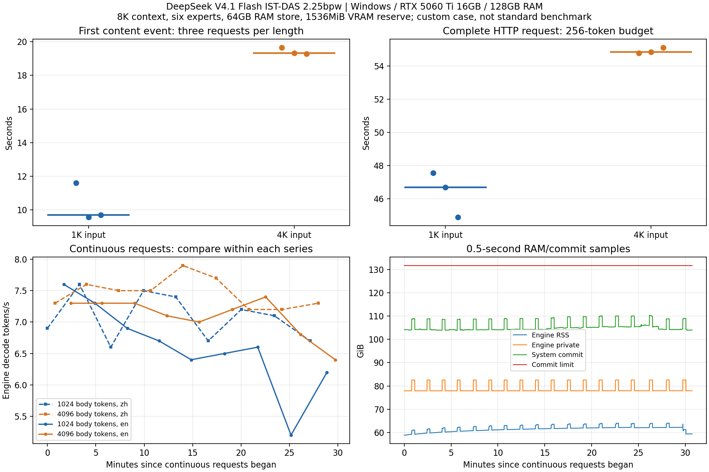

# DeepSeek V4.1 Flash 2.25bpw: Windows commit-headroom case

Measured on 2026-10-29 by Thymos2027. Official DeepSeek engine 0.1.52, one RTX 5060 Ti 16GB, i7-12700, 128GB DDR4, Windows 11. Results and a deployment failure; no engine patch or standard-benchmark claim.

The automatic RAM-store load exhausted Windows commit headroom. A manually bounded 64GB store with 1536MiB GPU reserve completed the functional checks, six timing requests and 30m44s of continuous requests. Some late requests slowed down. This does not establish an optimal budget, universal workaround, or root cause in a particular allocation.

## Environment and identity

- Windows 11 10.0.26200; Python 3.12.7.
- i7-12700: 12 physical / 20 logical cores; 137,140,031,488 bytes physical RAM, DDR4.
- One RTX 5060 Ti, 16311MiB; NVIDIA driver 610.88; model files on a ZHITAI TiPro9000 4TB NVMe.
- Pagefile postflight configuration: initial 4096MiB, maximum 8192MiB, system-managed=false. A usage snapshot after recovery reported 4096MiB allocated. The actual event had a145.730GB commit limit; later runs had141.435GB. It was not a fixed4GB allocation throughout.
- The normal Qwen service was unloaded before every DeepSeek run and restored afterwards. Desktop, IDE and browser remained open; clocks and temperatures were not fixed or sampled.
- Native engine: signed release `0.1.52-windows-x86_64-cuda-cuda13`, BUILD commit `a42cc3d7df70`, CUDA13.0, sm86/89/120.
- Native exe SHA-256: `e2f9fce53017dd8c2318e3a5ce969b4bd00b64589bdf32355e8d4d691962e610`.
- Archive SHA-256: `f1a3ae88f770b0ef2a3adb9fc7a7166af79069532210bf0f9c7970845cb75865` (422,151,870 bytes). Signed feed, package signature, manifest hash and all package files checked.
- Source Python server checkout: `8857fb6c9a94c947f75e845b7e9abe74b97551c8`. This is not the native binary's build commit.

Model: `DeepSeek-V4.1-Flash-1017`, ISTA-DASLab GSQ-RCO IQ2_XS / IST-DAS-2.25bpw. Seven ModelScope files, 273,803,820,973 bytes. Four backbone shards and Engram from ISTA; DSpark and the5.8MB metadata shard from Unsloth. Each fixed revision, size and SHA is in [model-files.json](model-files.json). All seven files were fully rehashed successfully before these tests. The pack used setup.py's unmodified ISTA recipe and shipped `profile-2.25.bin`; no skip-tensors/dense override. Pack-info passed.

## Observed failure and conditions

The recorded native automatic command, started by the Python server:

```text
strata-dsv41.exe --serve --pack <PACK_DIR> --max-context 8192 --eos 1
  --vision off --dspark auto --dspark-conf 0.65 --experts 6 --gpus 0
```

No explicit store budget or GPU reserve. Log:

```text
ds4: RAM store: 113.3 GB of RAM free after the GPU's weights: store sized 101.3 GB, not 106.4
ds4: RAM store: up to 8899 slots of 11.4 MB (101.3 GB), policy 0, 8 reader threads, unbuffered reads
```

At19:23:30 local time, Windows System event 2004 reported:

| Field | Bytes |
| --- | ---: |
| SystemCommitCharge | 145,636,839,424 |
| SystemCommitLimit | 145,729,966,080 |
| strata-dsv41.exe CommitCharge | 118,554,161,152 |

Only93,126,656 bytes of commit headroom remained at that event. The native log contained `fatal   : Memory allocation failure`; a host command helper also failed to load a DLL with “The paging file is too small for this operation to complete.” The server had printed ready, but no functional request was sent. The controller tree was explicitly killed to relieve pressure and the daily service recovered. **No spontaneous native-engine crash exit code was captured.** There is one automatic-budget observation, not repeated independent failure trials.

See [event fields](failure-event-2004.json) and [automatic engine log](logs/automatic-engine.log). The event's computer/user/process identifiers and unrelated application details are omitted. A read-only postflight settings query established the initial/max pagefile configuration; the event itself supplies the commit charge/limit at failure. No pagefile, driver or OS setting was changed.

## Independent budget attempts

| Run | Store / GPU reserve | Outcome |
| --- | --- | --- |
| Automatic | auto / default | Event2004 and host allocation failures; explicitly terminated for recovery before functional requests |
| 80GB | `--ssd-cache 80 --reserve-mib 1536` | Nine functional requests and the first1K/4K pair completed; during the next request a controller guard terminated the engine at132,952,526,848 /141,434,998,784 bytes commit |
| 64GB | `--ssd-cache 64 --reserve-mib 1536` | Fresh functional checks, all six timing requests, and36 continuous requests completed; daily service restored |

The controller guard was94% system commit or less than4GiB available physical RAM, unchanged between manual attempts. **The80GB stop was protective termination, not an observed second OOM.** Default-to-success changed both store and reserve, so this is not a single-variable causal A/B.64GB is a tested setting, not the largest safe budget.

All recorded args are in [configurations.json](configurations.json). The64GB run retained8K, six experts (Full quality), text-only, single GPU and DSpark auto. DSpark was explicitly not loaded by auto. The recorded layout had5624 RAM-store slots; the log's estimated hot-expert preload was51.5GB.555/15360 experts were on GPU (5.77GB), dense weights5.86GB, initial free GPU memory1185/1075MiB on the two starts, CPU lane12 threads, long-prompt chunk4096. These are actual log fields, not a claim of all-RAM residency or DSpark benefit.

## Functional and latency results:64GB run only

Two new-process loads:18.203s and17.844s. OS page cache was not cleared; these are not cold-disk timings.

Nine HTTP requests covered Paris, English/Chinese literals, arithmetic JSON, an `absdiff` Python function checked on four integer pairs, a two-request marker conversation, an actual `add(a=17,b=25)` API tool call and a tool-result follow-up returning42. The preset checks passed. They are small functional probes, not overall model-quality evaluation.

The timing matrix used synthetic records, temperature0, thinking disabled, checkpoint=false,256-token output cap, three rounds with order1K/4K,4K/1K,1K/4K. All six produced256 tokens, finish=length and cache_n=0.

| Actual prompt tokens | First content event seconds median (range) | Full HTTP seconds median (range) | Prompt tok/s median (range) | Decode tok/s median (range) |
| ---: | --- | --- | --- | --- |
| 1038 | 9.697 (9.569–11.602) | 46.677 (44.887–47.558) | 107.3 (89.5–108.5) | 7.1 (6.9–7.3) |
| 4110 | 19.332 (19.286–19.649) | 54.850 (54.776–55.108) | 212.9 (209.3–213.3) | 7.2 (7.2–7.3) |

Client first content ignores empty events/keepalives; it is not an internal GPU first-token timestamp. Throughput is from each response's native timing fields, not tokens divided by full HTTP time.8K is the context cap; actual tested inputs were at most about4.1K. Full raw requests, outputs and SSE events are in [http-requests.jsonl](http-requests.jsonl), numeric rows in [requests.csv](requests.csv).

## Continuous requests and drift

19:38:57–20:09:42 local time:1844.141s,36 requests, four instruction/length groups of nine. All completed with256 output tokens, finish=length, cache_n=0; no request/protocol errors or protection stops.

| Instructions / actual tokens | HTTP seconds median (range) | Decode tok/s median (range) | Last3 / first3 median HTTP time | Last3 / first3 median decode speed |
| --- | --- | --- | ---: | ---: |
| Chinese /1048 | 46.366 (43.198–49.952) | 7.1 (6.6–7.6) | 0.979 | 1.029 |
| Chinese /4120 | 52.865 (51.398–56.265) | 7.5 (7.2–7.9) | 1.063 | 0.960 |
| English /1033 | 48.511 (43.586–60.216) | 6.6 (5.2–7.6) | 1.156 | 0.849 |
| English /4105 | 54.825 (53.504–60.130) | 7.2 (6.4–7.4) | 1.080 | 0.932 |

The English1K last-third median total time rose15.6%, decode speed fell15.1%. Free-generation outputs and per-request IDs differed. Thermal/clock/background causes were not isolated; there is no memory-leak, thermal-throttle or regression claim. “All requests completed” does not mean flat performance or long-term stability.



## Resources and I/O

Successful-run request samples, every0.5s: peak engine RSS63.990GiB, private82.561GiB, whole-card VRAM15.143GiB, system commit110.389GiB (118.529GB); minimum available RAM42.602GiB. Sampling had no reported errors. These are sampled peaks, not continuous maxima, and RSS/private/VRAM must not be added as independent pools.

System-all-disk read-counter deltas were69.99–92.07GB for each1K timing request (median73.10GB),80.56–82.43GB for4K (median81.56GB). The continuous phase added about2.766TB system disk reads and2.764TB process I/O read transfers. System counters include other processes/disks; process I/O is not exact physical SSD attribution. The run had substantial storage traffic. Page faults and Pages Input/Page Reads counters do not specifically measure pagefile swapping.

This box completed local text and small tool-call probes with roughly7tok/s, but4K first-content waits near19s and256-token requests near55s are material interaction costs. There is no real-project agent evaluation or comparison with Qwen/other builds.

## Evidence and validation boundaries

- `failure-event-2004.json`: selected original Windows event fields; no host/user identifiers.
- `failure-80GB-guard.json`, `logs/`: retained stops and native timing lines, with paths replaced by placeholders.
- `http-requests.jsonl`:52 actual HTTP requests/events/results (9 functional,1 warmup,6 timing,36 continuous).
- `resources.jsonl`:4384 request-associated0.5s samples. System scope and counter names remain explicit.
- `summary.json`, `requests.csv`: derived statistics from the successful run; earlier partial timings are not pooled.
- `source/`: recorded measurement/telemetry code and posthoc analysis/plot scripts, local paths replaced only. They retain dependencies on the original source environment and are **archives, not a portable GPU runner**. Original and published hashes are in `source-fingerprints.json`. No new GPU run of the sanitized source is claimed.
- `protocol-recorded.md`: protocol and amendments written before each respective run. Original hashes checked locally.
- `aggregate-input-notes.json`: the original aggregate held two mutable message lists (`gate-multiturn-a`, `gate-tools`) that later acquired follow-up turns. The per-request archives retained actual one-message inputs. This public JSONL uses those actual archives, not the mutated aggregate. Originals are retained locally.
- `verify_public.py`: added after measurements for offline checks against recorded HTTP events and native timing lines; it performs no inference.

Daily Qwen restored at20:10:30; health and unchanged configuration verified again after the run. Models, packs, binaries, full private paths and unrelated environment settings are excluded.

Not run: native source build, kernel/root-cause isolation, pagefile-size A/B, fixed thermal/clock A/B,8K actual input, concurrent/vision requests, forced DSpark, other backends or overnight stability. This report supports this manually bounded deployment and observed commit pressure, not a default change.

Related: [#1607](https://github.com/Niko1221/Strata/issues/1607) is earlier Qwen commit admission, not a claim of the same allocation path; [#4362](https://github.com/Niko1221/Strata/pull/4362) concerns over-reserving UMA context RAM above16K, whereas this run used8K. This is not a validation of that PR. Preparation and analysis were assisted by Codex; all measurements are local recorded runs.
