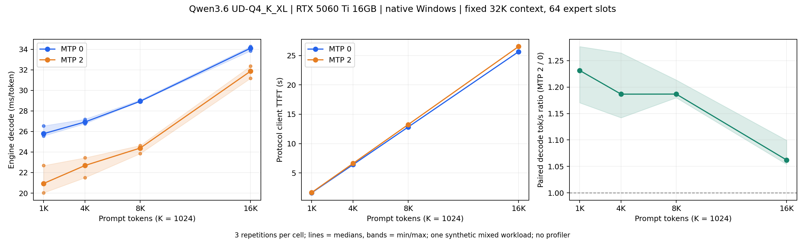

# 阶段 B：Qwen3.6 上下文长度曲线

测量日期：2026-10-22。目标：在已有 Windows 原生源码基线上，测实际输入增长时的 prefill、decode、首 token 延迟及资源变化。本轮不修改计算源码，不挂 profiler。

24/24 条测量成功，均生成 256 token；12 组 MTP 配对输出 token 哈希全部一致。原始数据在本机 `results.json`，脚本逐条写入成功、失败和遥测记录。结论限于下述固定布局和合成 workload。

## 环境与固定配置

- Windows 11、i7-12700、RTX 5060 Ti 16GB、128GB DDR4，驱动 610.88。
- [原生源码基线](../windows-native-baseline/README.md)：Strata `83e6b05cd7b97ee194f330f0247faa76deb73f1b`、MSVC 19.42、CUDA 13.2.0、sm_120。
- 本轮重新核对 `strata-q36.exe` SHA-256：`7abadfdbac3888b520cb00be77a5f2e70887acc95c8b98ab45316726f78a728b`，与阶段 A 一致。
- Qwen3.6-35B-A3B UD-Q4_K_XL，22,853,663,008 字节。使用阶段 A 同一个 GGUF；模型 SHA-256 沿用阶段 A 的实际校验记录，没有在推理期间再次扫描整个权重文件。
- 固定 `--max-context 32768 --prefill 512 --pool-workers 7 --expert-vram 10.0 --expert-slots 64`，solo，无视觉。
- 固定 `STRATA_Q36_FIXED_SLOTS=1`、K-quant MMQ prompt、packed Q8 decode、GPU 0、CUDA module eager；不启用 old-kernel、VERIFY 或 profiler。
- 原始协议明确设置 temperature=0、top_p=1、top_k=20、min_p=0、所有 penalties 关闭、seed=0，不经过 HTTP 模型卡默认采样合并。

实际布局以每次启动日志为准；请求预算 `--expert-vram 10.0` 不代表实际 10 GiB 专家驻留。MTP 是否执行以每条请求的 offered/accepted 核对。

本轮选择 prefill 512 延续阶段 A 的路径控制。此前报告中 auto/2048 chunk 的 TTFT 与本轮配置不同，不能直接据此判断版本退化。

## Workload 与运行顺序

`run_curve.py` 使用固定随机种子生成一份混合英文、中文和 Python 代码的合成 ledger。每条记录有不同编号、参数、函数与说明；其中数字全是虚构输入，不是 Strata 的性能测量。三个 repetition 使用不同种子。

从每份文本选取约 1K/4K/8K/16K token 的前缀，保留完整的末尾问题和聊天边界；避免截在 UTF-8 字符中间，并验证 tokenizer encode/decode 往返。截断仍可能在某个代码块中间，这属于该合成输入的定义。K=1024，实际长度为 1025、4096–4097、8193、16385 token，完整 IDs 与文本哈希保留。

每个长度有 3 次重复，MTP 0/2 两档，共 24 条测量请求。MTP 对照使用完全相同的输入 IDs。每个 repetition 启动两次全新引擎，顺序为：

| repetition | MTP 次序 | 输入长度次序 |
| --- | --- | --- |
| 0 | 0 → 2 | 1K → 4K → 8K → 16K |
| 1 | 2 → 0 | 16K → 8K → 4K → 1K |
| 2 | 0 → 2 | 4K → 16K → 1K → 8K |

每次启动先进行引擎自带 warm-up，再用不同 case 的约 1K prompt 生成最多 64 token 预热。预热数据保留在 arm 记录中，排除出 24 条测量。每条测量最多生成 256 token；保留实际输出长度、EOS/length 结束原因、所有输出 token 与哈希。模板使用空 thinking 块，不是标准 thinking-on benchmark 协议。

不同 case 的开头标签和内容避免延续前一会话，且强制核对每条 `reused=0`。静态专家布局不会随请求自适应换槽；warm-up 之后保留 OS/设备缓存，不人为清空文件缓存。因此这是 warmed、fresh-prefix 条件，不是冷加载基准。

CPU 亲和性通过 Windows 线程 API 读取。已观察到 7 个单 CPU mask 的 worker，其他线程允许系统调度；没有把它们都强制固定到单核。分析会检查 6 次启动的 worker mask 是否一致。该条件限制对 CPU 调度因果关系的推断。

## 计时与资源口径

- **引擎 decode ms/token**：DONE 的 decode_ms / 实际输出 token 数；作为主要曲线。decode tok/s 为其倒数换算。
- **引擎 prompt tok/s**：fresh token / DONE 的 prompt_ms。
- **客户端 TTFT**：原始 stdin/stdout 协议调用开始，到第一条生成 token `T`；包括发送和解析输入、prefill、首 token。不是 HTTP/API TTFT，不包含模型加载或 HTTP 排队。
- **客户端总延迟**：调用开始到 DONE；另存 first-token 之后的客户端 TPOT。
- **RAM**：psutil 的引擎进程工作集 RSS 和 private bytes，分别记录，不相加。每次请求约 0.5 s 采样，保存采样峰值；不是连续测得的绝对峰值。
- **VRAM**：NVML 的全卡 used/total；包含桌面和其他进程，不是引擎独占量。通过同样约 0.5 s 采样给出观测峰值。
- **分页**：保存进程总 page fault 增量、系统 PDH `Pages Input/sec` / `Page Reads/sec`、系统 swap-used。总 page fault 含软缺页，系统 PDH 含其他进程和文件映射，swap-used 也不是本请求的换页 I/O；不据此直接宣称模型发生/未发生磁盘换页。

PDH 首个速率点跨越请求开始前的时间，仅保留为原始记录，汇总请求期间的最大速率时排除该点。所有采样错误与缺失值都应在 summary 中保留。

不同长度的文本内容、生成答案及路由可能变化；即使固定 expert slots，曲线也不是仅改变 attention 长度的因果实验。MTP 两臂会单独核对输出哈希，一致性结论只适用于这些配对。

## 复现与原始产物

在项目根目录的 Windows PowerShell：

```powershell
python -u reports/tobeo-20261022/qwen36-context-curve/run_curve.py --prepare-only
python -u reports/tobeo-20261022/qwen36-context-curve/run_curve.py
python reports/tobeo-20261022/qwen36-context-curve/analyze_curve.py
```

需要已有原生构建，以及 psutil、matplotlib。运行脚本会通过本机控制接口暂时卸载原服务模型，结束或失败后在 `finally` 恢复原先已加载的模型；不修改日常配置。

`results.json` 已存在时拒绝重跑覆盖；应按新实验的日期/目录归档。生成输入时仍会更新相同定义的 workload 文件，因此已完成归档后也不要在其中运行 prepare-only，应复制脚本到新目录并调整其归档定位再复测。

| 本机文件 | 含义 |
| --- | --- |
| `workloads.json`、各 case `.ids.json` / `.prompt.txt` | 可重建输入、实际长度及哈希 |
| `results.json` | 每次测量、完整输出、PP/DONE、资源样本、失败和启动信息 |
| `r*-mtp*.engine.log`、`run.console.log` | 原始引擎与进度输出 |
| `summary.json`、`runs.csv` | 中位数、范围、每次结果、配对一致性与控制条件检查 |
| `context-curve.svg` / `.png` | 可独立导出的曲线图 |
| `resource-preflight.json` | 资源 API 可用性预检；不是推理峰值 |
| `service-transition.json` | 服务卸载和恢复状态 |
| `upstream-*.json` | 本次相关上游讨论与 PR 查询快照 |

报告、脚本和图允许进入 Git；本机原始 JSON/CSV/日志被忽略但保留。若公开贡献，应另行将必要的小型原始证据脱敏并纳入报告 PR。

## 上游刷新

2026-10-22 重新读取 [#2464](https://github.com/Niko1221/Strata/issues/2464) 及评论，搜索包含 `k_attn_part` 的 PR，命中 [#3084](https://github.com/Niko1221/Strata/pull/3084)、[#2698](https://github.com/Niko1221/Strata/pull/2698) 等历史工作。相关信息用于查重和解释研究问题；本轮继续固定阶段 A revision，没有声称实验使用最新 main。

## 测量结果



可导出的矢量图：[context-curve.svg](context-curve.svg)。线为三次中位数，阴影为最小值至最大值。三个 repetition 的输入内容不同，因此范围同时包含内容差异和运行波动，不是固定输入重复测量的噪声估计，也不是置信区间。

以下每格 n=3，decode 单位 tok/s，括号为三次最小值–最大值；ms/token、TTFT 和 prompt 吞吐均为各自中位数。

| 实际输入 token | MTP | decode tok/s（范围） | decode ms/token | 协议 TTFT s | prompt tok/s |
| --- | --- | --- | --- | --- | --- |
| 1025 | 0 | 38.78（37.67–39.11） | 25.79 | 1.632 | 628.56 |
| 1025 | 2 | 47.76（44.09–49.93） | 20.94 | 1.677 | 611.43 |
| 4096–4097 | 0 | 37.14（36.78–37.37） | 26.92 | 6.428 | 637.45 |
| 4096–4097 | 2 | 44.07（42.67–46.51） | 22.69 | 6.636 | 617.55 |
| 8193 | 0 | 34.56（34.40–34.57） | 28.94 | 12.834 | 638.47 |
| 8193 | 2 | 41.01（40.59–41.95） | 24.38 | 13.250 | 618.45 |
| 16385 | 0 | 29.32（29.18–29.55） | 34.10 | 25.648 | 638.92 |
| 16385 | 2 | 31.38（30.91–32.08） | 31.87 | 26.528 | 617.74 |

配对比值先按同一输入分别计算 MTP 2 / MTP 0 的 decode tok/s，再取三次中位数，不能用两个独立中位数的比值替代。草稿统计为三个 MTP 2 请求的接受数/提供数之和。

| 输入档位 | 配对加速比中位数（范围） | MTP 2 accepted/offered | 配对输出相同 |
| --- | --- | --- | --- |
| 1K | 1.231×（1.170–1.277） | 421/688 | 3/3 |
| 4K | 1.187×（1.142–1.265） | 437/656 | 3/3 |
| 8K | 1.187×（1.180–1.213） | 443/644 | 3/3 |
| 16K | 1.062×（1.054–1.099） | 439/652 | 3/3 |

本机观察：MTP 0 从 1K 的 25.79 ms/token 增至 16K 的 34.10 ms/token；MTP 2 从 20.94 增至 31.87 ms/token。MTP 在所有已测配对中改善 decode，但长上下文收益缩小；其协议 TTFT 略高。因此不能将 decode 收益直接称为每种请求总延迟的同等改善。

这 12 对输出一致，支持本轮固定布局下的对照。它不解释或推翻 2026-10-21 日常布局下六对输出不同的历史记录，也不是通用质量评测。

## 控制条件、资源与验证

**Passed：**

- `results.json` 的 complete=true；24/24 成功，每格 3 次；全部生成 256 token、finish=length，没有提前结束。
- 24 条请求 reused=0；12 对输入哈希一致、输出 token 哈希一致；MTP 0 全部 offered=0，MTP 2 全部 offered>0。
- 6 次引擎启动均为 context=32768、prompt chunk=512、每层 64/256 专家驻留 GPU（4.69 GiB），全部专家 18.75 GiB pinned host memory；各启动记录 slot replacements=0。
- 6 次启动的 7 个单 CPU worker mask 相同，对应逻辑 CPU 2、4、6、8、10、12、14；其他线程允许 OS 调度。亲和性查询没有错误。
- 共 928 个资源样本，采样错误 0；请求期间 PDH 两项计数无缺失。
- 脚本正常退出；服务从已加载的 `qwen3.8-flash-next-iq3_s` 暂时卸载后恢复，health.loaded=true，最大上下文仍为 65536。
- 三个 Python 脚本语法检查通过；报告、索引和研究计划的本地链接检查通过；`git diff --check` 通过。收尾再次请求 health 确认服务已加载，且没有残留的 `strata-q36` 测量进程。

**资源观测：**引擎工作集 RSS 采样峰值 41.93 GiB、private bytes 峰值 34.75 GiB；全卡 VRAM 采样峰值 15.19 GiB；系统可用物理内存采样最低 68.95 GiB。RSS 与 private bytes 口径不同，不能相加。进程每请求总 page fault 增量为 0–172，包含软缺页。排除各请求第一个速率点后，系统 Pages Input/sec 最大 2340.05、Page Reads/sec 最大 2240.85；系统确有分页相关活动，但这些计数既不能归因于引擎，也不能作为“没有磁盘换页”的证据。

**Failed：**本轮测量请求失败 0，汇总中的 9 项检查全部通过。系统级分页活动与非 worker 线程调度仍是测量限制，不能由通过检查消除。

**Not run：**24K/32K 输入、并发、日常动态专家布局、模型卡采样质量评测、HTTP 延迟基准、Nsight Systems/Compute、候选优化与跨后端构建。本轮没有引擎源码改动。

## 阶段结论与下一步

阶段 B 的最小矩阵和上下文曲线已完成。本机存在明确的长上下文 decode 变慢现象，且 MTP 收益随长度缩小，值得进入阶段 C；目前没有 kernel 级时间证据，不能认定 `k_attn_part` 已是主要瓶颈。

阶段 C 先用 Nsight Systems 分别捕获 1K/16K、MTP 0/2 的加载和预热之后的代表性请求，核对 decode 关键路径、CPU 专家工作、同步、拷贝与 GPU 空隙。只对时间线确认值得深入的 kernel 使用 Nsight Compute。正式性能曲线继续使用本轮未挂 profiler 的数据，profiling 计时单独归档；取得本机 trace 后再决定最小优化。
