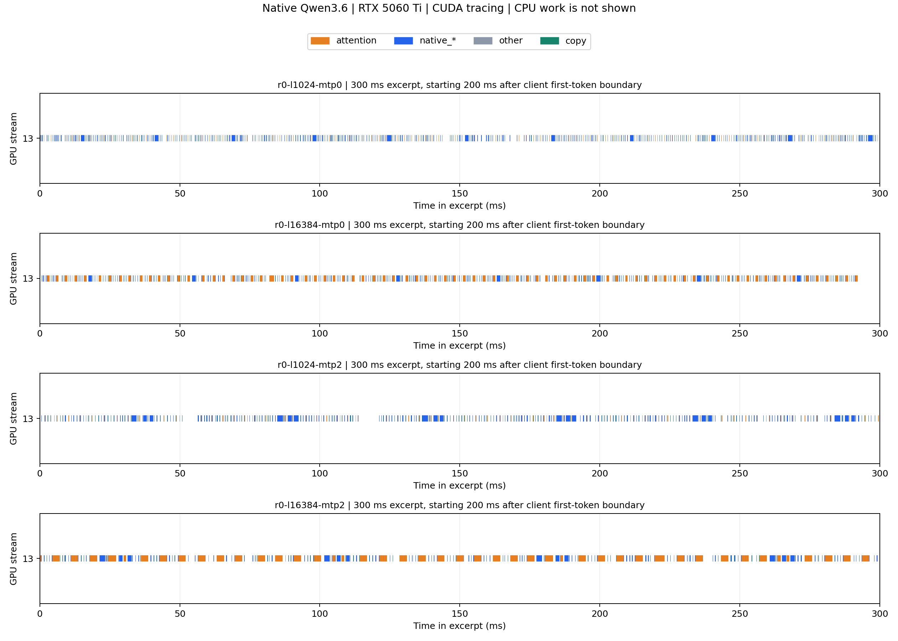

# 阶段 C：Windows 原生 profiling

日期：2026-10-22。接续[阶段 B 上下文曲线](../qwen36-context-curve/README.md)。本目录保存工具准备、采集驱动及真实执行状态，不把准备完成当作 profiling 完成。

## 目标与采集范围

选取阶段 B repetition 0 的 1K、16K 输入，分别运行 MTP 0/2，固定相同源码二进制、模型、32K 配置上限、512 prompt chunk、7 workers、64 专家槽位及贪婪协议参数。每个采集进程重新加载引擎，先做引擎 warm-up，再用另一份约 1K 输入生成 64 token，最后生成 64 token，并采集首 token 之后的 decode。每条输出与阶段 B 对应请求的前 64 token 核对。这是短窗口诊断，正式吞吐仍使用阶段 B 的 256-token、三次重复矩阵。

Python 驱动用已安装的 PyTorch NVTX CPU 绑定提供标记，不创建 torch tensor 或 torch CUDA context；Strata 仍在独立子进程中运行原生模型。Nsight 捕获该进程树的完整生命周期，包括加载和预热；分析仅筛选 `decode-after-first-token` NVTX 区间。该标记以协议客户端收到第一个 token 为边界，不能作为引擎内部精确阶段边界；第一条输出的接收与子进程继续计算可能重叠，因此不能假定窗口恰好等于 63 个完整 decode step。所有 GPU 区间裁剪到实际记录的 NVTX 时间边界，不用请求 token 数直接除 kernel 总耗时。

设置 `--cuda-graph-trace=node`，但本轮固定布局实际没有 CUDA Graph：固定 revision 的 `q36_engine.cu:2887–2889` 在 main-hybrid 模式将 `use_graph`、`mtp_graph` 关闭。不能因请求 Graph 或传入 node 选项就声称采集了 Graph 执行；需结合 graphNodeId、runtime API 和源码判断。本轮 profiler 速度和更短的输出窗口不能直接与阶段 B 的正式曲线混作性能 A/B。关闭 CPU sampling 和 context switch tracing，保留 CUDA API、GPU kernel、拷贝和 NVTX；其本身无法解释 CPU 专家计算的内部耗时，需要时另采 CPU 时间线。

## 工具来源

最初使用 CUDA 13.2.0 manifest 的 Nsight Systems 2025.6.3.343，成功试采四组 256-token 完整请求，但导出诊断发现当前驱动报告 CUDA 13.3，旧版 Nsight 不支持该驱动并回退到 13.2 库，同时有事件完整性警告。这四组结果及预检保留在本目录根部，作为兼容性试采，不用于正式瓶颈结论；服务已按 finally 恢复。

正式采集改用 CUDA 13.3.1 manifest 的 Nsight Systems 2026.1.3.425，不声称它是最新 Nsight。仅更新 profiler，推理引擎仍为阶段 A 的 CUDA 13.2 构建，exe 哈希不变。

新版最初在首 token 时用 NVTX 触发采集（`cuda133/` 目录），四组请求和输出校验均通过，但触发期间控制进程阻塞，前段 decode 未完整进入 trace。该试采也保留，不用于正式占比结论。最终改为进程启动时采集、事后筛选 NVTX，归档到 `cuda133-process/`，避免把采集启动延迟当作模型执行或漏掉早期 decode。

- [官方 manifest](https://developer.download.nvidia.com/compute/cuda/redist/redistrib_13.3.1.json)
- archive 大小：534,002,207 bytes，已实际核对。
- 实测 SHA-256 与 manifest 相同：`d05b7735036b96689dc10fc0899454fbe0edcc3ac10e4c7f52f98d29c327f192`。
- 保存到项目忽略的 `build-native-baseline/toolchains/`，无需安装器，不修改驱动或系统 PATH。
- 下载使用 8 MiB 分段、断点续传、重试及 SHA-256 校验；新增准备互斥锁、可配置并发和超长分段隔离。连接曾超时，续传期间发现两个超长分段，已保留为 invalid 文件并重新下载，最终整包哈希通过。旧日志保留，成功日志为 `prepare-cuda133-repair.console.log`，实装记录为 `nsight-installed-13.3.1.json`。

官方说明：[Windows CLI 的管理员要求](https://docs.nvidia.com/nsight-systems/UserGuide/index.html#installing-the-cli-on-your-target)、[CUDA Graph trace 的粒度与开销](https://docs.nvidia.com/nsight-systems/UserGuide/index.html#cuda-graph-trace)。本轮终端实际权限预检为非管理员。`nsys status --environment` 报 Administrator privileges: No、Sampling Environment: Fail；但该版本 `profile --help` 说明 sample/process-tree 与 cpuctxsw/process-tree 需要管理员，而关闭两者后的 NVTX 预检已实际成功。不要把 sampling 检查失败直接当作 CUDA/NVTX 无法采集。

## 复现

项目根目录的 Windows PowerShell，使用同一 Python 环境（本机 PyTorch `2.7.0.dev20250311+cu128` 的 NVTX 绑定已实测可调用）：

```powershell
python -u reports/tobeo-20261022/qwen36-profiling/prepare_nsight.py
python -u reports/tobeo-20261022/qwen36-profiling/run_profiling.py --preflight-only
python -u reports/tobeo-20261022/qwen36-profiling/run_profiling.py
python -u reports/tobeo-20261022/qwen36-profiling/export_traces.py
python -u reports/tobeo-20261022/qwen36-profiling/analyze_traces.py
```

本轮实际 Python 为 `D:\Program Files\Anaconda\python.exe`。新终端若 PATH 不同，应显式使用 `& 'D:\Program Files\Anaconda\python.exe' ...`，避免换到没有 NVTX 依赖的环境。

正式命令会先验证 CLI/NVTX 采集，再卸载日常服务模型，依次采集四个请求，并在 finally 恢复原服务。默认归档目录为 `cuda133-process/`；它会核对输出与阶段 B 对应请求的前 64 个 token 是否逐 token 一致。不能只以 `.nsys-rep` 存在判断采集完整或正确。已存在结果时拒绝覆盖，应换日期/实验目录；原始 trace 和日志不入 Git，小型 `trace-summary.json` 与图允许入 Git。导出和分析应在四组采集完成之后运行，避免 CPU 分析负载干扰测量。

`--preflight-only` 不卸载日常模型。若已有成功的 `cuda133-process/preflight.nsys-rep`，正式命令会复用经检查的预检，而不会覆盖它。失败日志也应保留，修正参数后的重试需使用新文件名。

预检脚本会复用同一命令已成功产生的预检报告。保留失败证据后，可用 `--preflight-tag preflight-2`（后续依次递增编号）重试；新采集必须仍检查实际 NVTX/GPU 内容，不能把复用预检解释为模型请求采集通过。

## 执行状态

**Passed：**新版工具大小、SHA-256、版本检查通过；四组完整生命周期采集均正常退出。每条正式请求输出 64 token，输入哈希与阶段 B 相同，输出与其前 64 token 逐 token 一致；实际 MTP、fresh token、finish=length 检查通过。四份 SQLite 均有闭合 decode NVTX 范围和独立引擎进程的 GPU 活动。六项汇总检查全部通过，没有驱动回退、引擎进程 CUDA 警告或明确的事件丢失/overflow/error 诊断。原 Flash-Next 服务已恢复，health.loaded=true。

**Warnings / 限制：**完整诊断仍有 No NVTX、Not all NVTX、No CUDA、CUDA profiling might have not been started correctly 提示，原文和进程标识保留在汇总中。引擎没有 NVTX 标记，控制进程只使用 NVTX、不运行 CUDA 模型；不能把这些控制/标记范围提示混作引擎 CUDA 采集失败，也不能写成“全部警告为零”。所分析的 decode 范围已闭合，且引擎进程没有 CUDA 完整性警告。窗口边界来自客户端接收，不能保证刚好覆盖 63 个完整 step。

**Failed / 未采用的试采：**旧 Nsight 对当前驱动的兼容性试采不用于结论；新版 NVTX 触发试采因启动阻塞截短 decode，也不用于正式占比。两个下载超长分段被隔离、重下后，整包校验通过。所有这些原始证据保留，没有覆盖或冒充成功的正式采集。

**Not run：**Nsight Compute 硬件计数、CPU sampling/context switch、无 profiler 的候选 A/B、独立 Graph 执行、并发、动态专家布局与候选 kernel。本轮没有修改计算源码。

收尾验证：相关 Python 脚本语法、本地 Markdown 链接、SVG XML/行尾及 `git diff --check` 通过；再次请求 health 确认 Flash-Next 已加载，未发现残留 `strata-q36` 测量进程。

## 正式 decode 结果

数据入口：[trace-summary.json](cuda133-process/trace-summary.json)。单位均为 ms，GPU 活动为 kernel、memcpy、memset 区间的并集；空隙为 NVTX 窗口减该并集。每种配置仅一份诊断 trace，不是三次重复的性能估计。

| 实际输入 / MTP | NVTX 窗口 | GPU 活动并集占比 | memcpy 并集 | 未覆盖时间 | k_attn_part 占窗口 |
| --- | --- | --- | --- | --- | --- |
| 1025 / 0 | 1827.43 | 28.31% | 15.76 | 1310.16 | 2.63% |
| 16385 / 0 | 2510.76 | 41.40% | 21.60 | 1471.42 | 22.05% |
| 1025 / 2 | 1628.12 | 28.30% | 17.60 | 1167.35 | 3.46% |
| 16385 / 2 | 2480.02 | 51.10% | 18.07 | 1212.79 | 34.45% |

四个窗口的 kernel/memcpy 观测重叠均为 0；不能由此推广其他布局或请求没有重叠。未覆盖时间包含未采样的 CPU 工作、host/driver 调度、同步及 profiler 开销，不能直接称为 CPU 专家时间、PCIe 瓶颈或“GPU 闲置导致的可回收收益”。

`k_attn_part` 明细，调用次数指与窗口相交的记录；耗时先裁剪到窗口，均值可能含边界处的部分调用，不按 63 个输出直接归一化：

| 输入 / MTP | 调用数 | 累计 ms | 均值 μs/调用 | 中位数 μs/调用 |
| --- | --- | --- | --- | --- |
| 1K / 0 | 610 | 48.07 | 78.81 | 78.78 |
| 16K / 0 | 621 | 553.58 | 891.43 | 878.43 |
| 1K / 2 | 354 | 56.28 | 158.98 | 160.30 |
| 16K / 2 | 355 | 854.36 | 2406.64 | 2597.09 |

MTP 0 的单次均值约增长 11.3 倍；同臂 `native_q8_0_packed_kernel` 均值约 42.81 → 42.52 μs，基本不随长度增长。16K 中 attention 已是累计 GPU 耗时最高的 kernel，值得进一步检查。MTP 两臂的 query row 与验证机制不同，不能仅按单次调用耗时比较工作效率。

实际 Graph 检查：四组 graphNodeId 非空的 kernel 数均为 0，`cudaGraphLaunch` 调用数也均为 0，与 hybrid 关闭 Graph 的源码条件相符。阶段 A 两份报告和阶段 B 配置说明已据此更正；保留历史 `graph-*` 文件名及原始输出，没有更改既有数据。

## 时间线与下一步



[矢量图](cuda133-process/decode-timelines.svg)。每组固定取客户端 decode 边界后 200–500 ms；只显示 GPU stream 13，CPU 工作不在图中。橙色为 attention 系列，蓝色为 native_*，灰色为其他 kernel，绿色为 copy；类别只按 kernel 名称划分，不代表完整的算法阶段或 CPU 专家计时。

Systems 部分已完成，阶段 C 的访存归因尚未完成。具体判断和下一步门槛见[瓶颈观察与待验证假设](bottleneck-notes.md)：先用 Nsight Compute 检查长上下文的 `k_attn_part`，再决定是否实现保持 FP32 K/V 的协作读取/tile 原型。当前没有修改 kernel，也没有测得自己的优化加速。

## 分析验收

获得 trace 后先导出 SQLite，检查正式范围、GPU kernel 数量、MTP 实际状态、输出一致性和是否发生丢事件。仅分析预热之后的请求；统计主要 kernel 总时长和调用次数，并按时间区间的并集分析 GPU busy、拷贝与空隙，不能把跨流重叠时间相加当作总延迟。

本轮 Systems 证据已支持深入 attention，但尚未运行 Nsight Compute，不能把候选访存解释当成已确认根因，也不把上游 V100 的数值当成本机结果。
