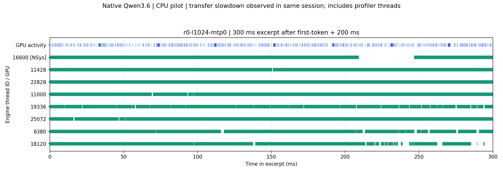

# CPU IP 试采与同日传输性能异常

日期：2026-10-23，北京时间。设备、模型与冻结基线沿用前日报告。**本轮确认主机到 GPU 的传输吞吐明显低于历史记录；同日不挂 profiler 的 prefill 也慢，不能把慢速归因于 CPU 采样。** 正常工况的性能 A/B 暂缓，日常 Flash-Next 已恢复加载。

## 环境对照

| 检查 | 实测 |
| --- | --- |
| 同日无 profiler、1K 输入 prefill | 23,045.2 ms；64 个输出与阶段 B 前缀一致 |
| 本轮 CPU IP trace、相同 1K prefill | 22,730 ms |
| 阶段 B 历史 1K prefill | 1,630.7 ms；历史输出上限为 256，本轮为 64 |
| 64 MiB ×512 拷贝，预热至少 2 s | 1.732313182 GB/s，日常模型已加载但无推理请求 |
| 卸载日常模型后，重复同一探针 | 1.733931810 GB/s |
| 重放冻结引擎原始探针：256 MiB、4 个 burst 取最好 | 1.734539575 GB/s；每个 burst 显示 1.7 GB/s |
| 10 月 21 日引擎日志中的同类探针 | 24.9–25.0 GB/s |

本轮独立诊断没有挂 profiler。64 MiB 测试使用 pinned host memory、CUDA Event 计时，抽查拷贝后的首 4 字节；实际计时总量为 32 GiB。另用 `run_engine_pcie_probe.py` 从冻结源码原样提取 `probe_pcie_h2d_gbps()`，复现引擎的 256 MiB、四次 burst 方法。它也慢，不能用微基准大小或日常模型显存占用解释这一差异。

负载期间 `nvidia-smi`/NVML 连续报告 GPU current/max generation 为 1、host max 为 5、宽度为 ×8；当时 P1、graphics 2835 MHz、memory 13801 MHz、约 47°C。**Windows PnP 属性却返回 current/max speed code 5、current width 8。两套报告有冲突，未确定物理链路、驱动报告或传输路径的具体原因。** 确定的结论是当前 HtoD 吞吐低，不能仅用空闲时的 Gen1 读数下结论，也不能宣布显卡损坏。

源数据与完整负载采样见 [environment-summary.json](environment-summary.json)。本机原始记录位于 `unprofiled-control-01/`、`pcie-diagnostic-01/`、`pcie-diagnostic-02/`、`pcie-engine-probe-01/`。此前 kernel replay 发生过 TDR，但缺少前后连续的链路记录，尚不能把它确定为本轮异常的原因。未改驱动、链路设置、时钟、Windows 电源或 TDR 设置。

## CPU 试采的实际范围

使用已校验的 Nsight Systems 2026.1.3.425、同一冻结 exe，1K/MTP 0、固定 64 专家槽位、7 workers、32K 配置上限。正式输出 64 token，与阶段 B 一致。

- `cpu-sampling-01`：开启即时符号解析，预检报告生成停在 46%；主动停止，保存原始 qdstrm。此时尚未卸载日常模型。
- `cpu-sampling-02`：关闭即时解析，1K 的完整回溯/调度采集成功，保留报告和 SQLite。看到时间与历史差异过大后主动停止 16K，服务恢复成功。事后同日无 profiler 对照证明，不能把这项差异直接称为 profiler 开销。
- `cpu-sampling-03`：500 Hz CPU IP 采样、context switches、`backtrace=none`、`resolve-symbols=false`，采到完整 1K 请求。历史时间差检查阻止继续 16K；该检查只是环境漂移提示，不证明 profiler 有问题。保存了实际模块加载地址，用本地匹配 PDB 离线解析叶子 IP。

Windows Performance Toolkit 未安装，工具没生成 merged ETL；`.nsys-rep`、SQLite 的 CPU 样本和调度事件仍存在。当前证据是周期 IP 和调度事件，不是完整调用栈。后续需要完整栈时再单独验证其开销。

| 1K decode 范围内 | 实测 |
| --- | --- |
| 客户端 first-token 后 NVTX 范围 | 2,513.874 ms |
| GPU kernel/copy/memset 区间并集 | 627.818 ms |
| GPU 未覆盖时间 | 1,886.055 ms，约 75.0% |
| 引擎进程周期样本，cpuCycles=1 | 10,870 |
| `ExpertPool::worker` 叶子 IP | 5,814，约 53.5% |
| 其中 `pool.cpp:712` 等待工作循环 | 5,550，约 51.1% |
| q4_K/q5_K/q6_K dot 函数合计 | 2,610，约 24.0% |

这些比例的分母是引擎进程的所有周期样本，包含注入的 profiler 线程，不是 CPU 使用率或端到端时间占比。`pool.cpp:711–712` 是 `_mm_pause` 和等待循环计数。**on-CPU 包括有意自旋等待，不能把 GPU 空隙或 CPU 活跃时间全部算成专家矩阵计算，也不能由自旋样本占比宣布它处于关键路径。** 本轮没有改变等待策略。

离线符号解析使用实际记录的进程/模块基址、原 exe 旁的匹配 PDB 和 DbgHelp；只统计周期事件的 leaf PC，排除调度事件栈混入热点。方法参照 [Nsight SQLite 分析说明](https://docs.nvidia.com/nsight-systems/AnalysisGuide/index.html)。解析本地符号的地址回环检查通过；属于引擎 image 的样本没有未解析项。完整结果见 [summary.json](summary.json)。

CPU trace 没有同步采样 PCIe 代际；低 HtoD 吞吐是在同一会话稍后独立确认的，不能向旧记录回填一个推测的链路值。该 1K 试采只能解释当前异常会话的部分行为，不能代表正常 Gen5 下的 CPU/GPU 关键路径。16K CPU 归因仍未完成。



[SVG](cpu-gpu-timeline.svg)。蓝色是 GPU 活动并集；绿色是线程被调度上 CPU 的区间，含等待与 profiler 线程。窗口为客户端首 token 后 200–500 ms，线程按完整 decode 范围的 on-CPU 时长选前八个。

## 下一步与验证状态

2026-10-23 20:17（北京时间）再次运行同一 64 MiB ×512 pinned HtoD 探针：**1.732420997 GB/s**，19,833.365234 ms，首四字节抽查通过，退出码 0。证据保留在本机 `pcie-diagnostic-03/result.json`。负载期间 P1、graphics 2835 MHz、memory 13801 MHz，NVML 仍报 current/max Gen1、host max Gen5、×8；随后读取的 PnP current/max speed code 仍为 5、宽度 ×8。未恢复，具体原因仍未确定。日常服务 `/health` 为 `status=ok, loaded=true`，没有卸载模型或更改系统设置。

用户只能远程访问，且存在开机前密码的可能，当前不安排重启、显卡重置或驱动维护。重启能否恢复尚未验证；需要确认开机解锁和远程恢复路径后再安排维护窗口。无重启条件下的研究顺序见[后续实验安排](no-reboot-next-steps.md)。以下探针可按需复测，不需要反复轮询。

```powershell
& 'D:\Program Files\Anaconda\python.exe' 'E:\Coder\LLM\Strata\reports\tobeo-20261023\qwen36-profiling\run_pcie_probe.py'
& 'D:\Program Files\Anaconda\python.exe' 'E:\Coder\LLM\Strata\reports\tobeo-20261023\qwen36-profiling\run_engine_pcie_probe.py'
```

两个入口自动选新编号；结果按北京时间开始日期归档。确认环境后，先重建同日无 profiler 对照，再恢复 1K/16K CPU 分析、L2/L1/occupancy 采集与五组性能配对。

**Passed：**同日无 profiler 输出验证；三次传输探针；1K IP/调度数据、模块基址和本地 PDB 解析；数值/单位/区间检查；各次模型切换后的服务恢复。

**Stopped / limited：**即时符号解析预检、完整栈 16K 试采、历史时间差门禁；原始记录保留。没有把这些停止步骤当作 GPU 计算错误。

**Not run：**正常传输条件下的完整 CPU 归因、16K CPU trace、链路恢复后的性能基线和正式 A/B。当前不打勾研究计划的最终瓶颈结论与优化交付项。
