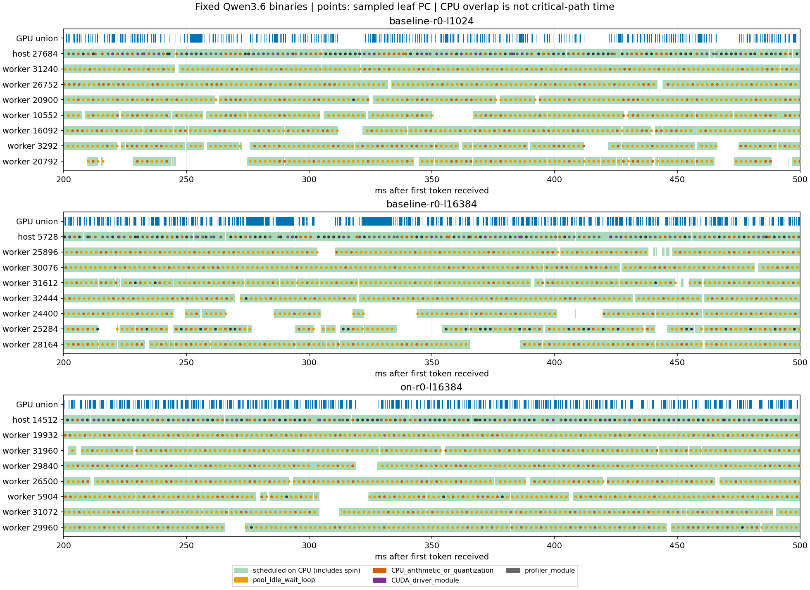
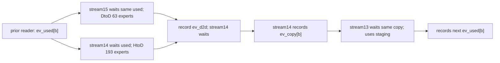

# 正常工况CPU归因与PR3905复制依赖

2026-10-30 18:00发布更新：本报告的新增补充已按授权发布到[PR3905跟进评论](https://github.com/Niko1221/Strata/pull/3905#issuecomment-6518999609)，脱敏证据和upstream870aedd9源码更新见[发布记录](../qwen36-pr3905-followup/README.md)。下文“未外发”及summary中的publication字段保留测量时状态；原始证据和结论不变。后续根因调查使用870aedd9独立重验。

2026-10-30，北京时间。接续[已发布复制验证](../qwen36-copy3905/README.md)，[执行前协议](experiment-plan.md)保持46c152a1及原配置。**已完成正常HtoD下的CPU周期IP/调度采集，能区分专家算术、worker等待和CUDA查询；原始两条复制trace还补齐了320步字节守恒、双缓冲event依赖与stream优先级元数据。** 这不是精确CPU关键路径分解，不据样本比例修改等待策略或默认参数。本轮新证据尚未向上游发布。

## 配置、门槛与采集范围

原Qwen3.6 UD-Q4_K_XL、32K上限、chunk2048、显式63slots后冻结、7workers、MTP0、packed/MMQ、贪婪无penalty，1K/16K输入实际1025/16385token，64输出。baseline是原46c152a1二进制；on是此前验收的af08278c复制切片，仅加--split-stage-copy，不是整套PR3905。源码、exe、DLL、PDB与原数据分开记录，没有重建或更换引擎。

当前管理员和Nsight Sampling Environment=OK；CPU-only预检在卸载日常模型前实际取得1851个本探针周期样本、13899条调度事件。随后baseline/1K、baseline/16K、on/16K各一条同日无profiler参考和一份500Hz process-tree IP/context-switch CPU/CUDA/NVTX trace。backtrace=none、resolve-symbols=false，模块基址在各进程同一预热后记录，本地匹配PDB离线解析。每进程同一1K/64输出预热，六条测量输出均与旧参考完整相同、fresh/0草稿、63slots/2048chunk/0换槽、退出0。

HtoD前24.862111/后24.942329GB/s；12:05:08恢复原Flash-Next0.1.52，loaded=true、模型及日常配置SHA相同，无恢复错误。按[NVIDIA说明](https://docs.nvidia.com/nsight-systems/UserGuide/index.html)记录实际采样环境，管理员标志没有代替真实样本门槛。

## CPU样本能说明什么

仅按引擎PID及decode-after-first-token客户端窗口筛选周期leaf IP，排除context-switch栈混入。下表分母是该引擎进程**全部周期样本**，包含profiler注入线程，不是请求耗时或CPU使用率。

| 格 | 周期样本 | worker等待循环 | 算术/量化 | 内核态地址未解析 | profiler模块 |
| --- | ---: | ---: | ---: | ---: | ---: |
| baseline-r0-l1024 | 9448 | 51.99% | 25.84% | 12.32% | 4.28% |
| baseline-r0-l16384 | 12093 | 52.63% | 20.09% | 13.45% | 6.95% |
| on-r0-l16384 | 11867 | 54.34% | 21.88% | 12.15% | 6.02% |

worker等待主要定位到固定源码pool.cpp:1014及1000附近，属于epoch等待循环（分类范围1000–1028），不是专家矩阵乘。算术主要是ggml_vec_dot_q4_K_q8_K、q5_K/q6_K及native_gu/down_rows，不能把worker整个函数或所有on-CPU时间叫作有效计算。每格识别出七个pool worker和一个CUDA提交主线程；引擎image内样本均解析成功，0未解析。表中内核态PC来自负的有符号64位地址，用户态模块快照不覆盖它们；没有假装用引擎PDB解析内核或猜它们的函数。其他模块、控制/等待等类别完整保留在[cpu-summary.json](cpu-summary.json)。

原基线16K窗口2745.06ms，其中GPU未覆盖1531.06ms。已识别的2430个算术/量化样本全部落在GPU空隙中；1K为2441/2441，on/16K为2596/2597。这证明这些采样时刻存在CPU算术执行，明显强于旧报告只凭空隙推测，但不等于所有空隙都由专家算术造成，也不能从多worker样本数估算并行wall time或直接换算可回收延迟。

基线16K提交主线程记录2767380次cudaEventQuery；API区间并集994.76ms，只有246.89ms与GPU空隙相交，其余主要与GPU活动重叠，不能当作约1秒串行等待。运行时returnValue原始字段均为0，本报告不由该字段推断event是否ready或计算not-ready比例。pool wait_done和作业组织也有样本，但缺少逐层job生命周期及完整调用栈，仍不能作完整因果关键路径分解。即使engine on-CPU几乎覆盖全部GPU空隙，也包含有意自旋及注入线程，不是CPU专家耗时。



图为首token收到后200–500ms，显示CUDA提交主线程和七个worker；绿色是实际调度on-CPU，点为周期leaf IP，橙色等待循环、红色算术/量化。其他线程仍在完整JSON分母与统计中。

## 采集扰动与缺项

每格n=1，组合采集/plain的prefill比分别0.946/1.005/1.009，decode比分别1.165/1.152/1.104。此差异包含CPU采样、CUDA/NVTX跟踪、注入线程、采集顺序及环境波动，未单独隔离CPU采样开销。因此CPU样本仅描述这些被采样的进程，不替换已发布五组无profiler配对，也不根据on/baseline单点判断新的decode收益。

每trace保留原四条角色诊断，并多一条Windows Performance Toolkit未安装、不能生成merged ETL的警告。实际SQLite CPU周期样本、SCHED_EVENTS、引擎CUDA事件和客户端范围均存在；未安装WPT，没有merged ETL或完整栈，不把警告写成零。没有检测到明确lost/dropped/overflow/error诊断；此项检查不证明所有可能事件均已采全。

## 复制机制新增证据

以下离线核对使用此前off/on两份原SQLite，首先校验其原始manifest SHA，不是新性能采样。

- 每臂320次staging，copy事件在两个buffer间交替、各160次。逐次核对A的HtoD字节等于B的HtoD+DtoD，B的DtoD严格为63/256，HtoD为193/256；不是只比较总量。[逐stage明细](mechanism-stages.csv)。
- 320条链均通过eventId+eventSyncId及runtime correlation关联：写buffer前HtoD与DtoD流等待同一代ev_used；DtoD完成事件由HtoD流等待后record ev_copy；计算流等待这一代ev_copy再使用buffer。事件反复复用，不能只按eventId跨代连接。相关record/wait/copy API的returnValue均为0。
- 实际TARGET_INFO_CUDA_STREAM记录：计算13/host-copy14优先级0，新DtoD流15的原始无符号值4294967291，按int32解读为-5。此前缺少此元数据核对；这是已分配的stream优先级，不是硬件抢占或独立性能因果证明。
- DtoD并集208.49ms，与HtoD重叠193.96ms（约93.0%），与计算kernel重叠9.11ms（约4.4%）。独立流没有与所有GPU工作都并行；不能把各copy/kernel总时长直接相加。
- copy event的设备完成timestamp均为0，本次只确认CPU入队及record/wait关联，不能捏造GPU event完成时刻或stream wait的实际设备等待时长，也没有逐字节转储staging内容。



图中是已核对的依赖与源码语义，不是按比例的设备时间线。[CUDA文档](https://docs.nvidia.com/cuda/cuda-programming-guide/02-basics/asynchronous-execution.html)说明优先级是提示，不能保证执行顺序或抢占；本轮没有第三个复制臂，无法独立分离分段、独立stream及优先级各自收益。[CUPTI事件关联说明](https://docs.nvidia.com/cupti/13.3.0/api/structCUpti__ActivitySynchronization2.html)用于核对关联字段，不把同步API跨度当设备停顿。

## 复现与下一步

```powershell
python -u reports/tobeo-20261030/qwen36-cpu-mechanism/capture.py
python -u reports/tobeo-20261030/qwen36-cpu-mechanism/analyze_cpu.py
python -u reports/tobeo-20261030/qwen36-cpu-mechanism/analyze_mechanism.py
python -u reports/tobeo-20261030/qwen36-cpu-mechanism/finalize.py
```

capture要求管理员、拒绝覆盖capture-01，并在异常路径尝试恢复同一服务。复跑另设目录并同步分析入口。分析脚本只读数据；CPU分类、图和机制核对在采集后编写。原日志、模块基址、nsys/SQLite及命令保留在本机capture-01，原复制trace和94文件manifest未修改；公开小汇总见[summary.json](summary.json)、[CPU结果](cpu-summary.json)、[复制结果](mechanism-summary.json)。

当前闭环是“正常传输+CPU IP/调度+可定位的等待/算术+逐stage复制依赖”；完整job级关键路径、内核态符号及全栈仍缺。下一项先明确最小观测方案，不直接改worker等待策略，不组合GQA/#4335/#4347，不用采样比例承诺加速。[PR3905补充材料草稿](pr3905-followup-draft.md)只留本地，未发送。
