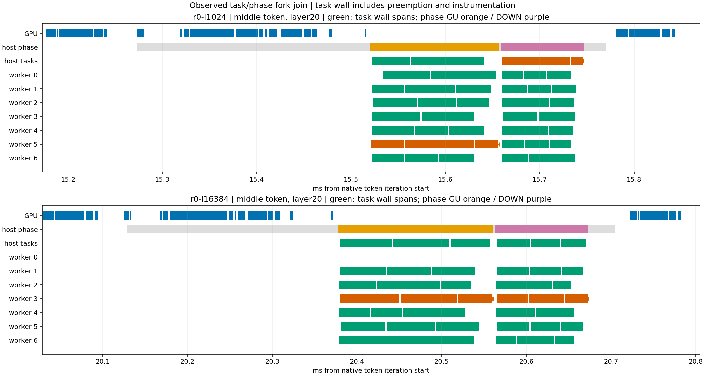

# Qwen3.6 job 级依赖与关键路径诊断

2026-10-30 收尾。固定 `46c152a1` 和原推理配置，已完成独立诊断构建、两轮采集、实际完成顺序核对及最终文件/数值/账本验收。后台于北京时间13:39:26完成封存；本次再次核对全部161份静态证据及manifest指纹通过。受控诊断中的job依赖和wall账本已完成；未插桩版本的唯一全系统根因仍未确认。

## 配置与范围

硬件为i7-12700、RTX 5060 Ti 16GB、128GB DDR4、Windows 11，驱动610.88。源码完整revision为 `46c152a1310f77cd2f0ce2c7cd213962df14fe83`，源码引擎0.1.53，CUDA13.2/sm_120。模型为Qwen3.6-35B-A3B UD-Q4_K_XL，22,853,663,008字节，SHA-256 `55983c5a75a1ab969824077b3bb3de4146e82a9234072b48ad4e8f92ad3fe9f1`。

保持32K上下文、chunk2048、63专家槽位且冻结驻留、7workers加主线程、MTP0、packed/MMQ、GPU0、贪心采样。每次使用独立进程及相同64-token预热。两个输入实际为1025/16385 token，各输出64 token；首个输出由prefill得到，因此细化decode窗口各含63次原生迭代。没有启用PR3905 split-stage-copy，当前结果是原复制路径的job诊断，不能当作复制开关的配对结果。

[初始协议](experiment-plan.md)、[完成序号补充协议](completion-plan.md)、[诊断头](job_trace.hpp)、[首轮补丁](diagnostic.patch)、[最终补丁](diagnostic-complete.patch)。独立worktree中的NVTX诊断由 `STRATA_Q36_JOB_TRACE=1` 开启；原基线源码和二进制保持不变。没有改变算术、任务claim、等待策略、任务数或日常默认。

## 如何确定完成路径

按原生token → MoE层 → GU/DOWN phase → 行任务关联CPU标记与CUDA API/设备操作。每个phase有24个行任务，由主线程和7个worker共同领取；任务是有序CPU专家行数组的分片，不能称为一个完整专家，也不能直接当成模型全局专家ID。

首轮仅凭任务范围结束时间选择末尾任务，这只是代理。第二轮在原 `done_.fetch_add(1, memory_order_release)` 后记录其返回序号，不增加共享完成计数；逐phase检查任务唯一性、行覆盖及完成序号1..24各出现一次，以ordinal=24确定真实最后完成发布者。

| 核对项 | 1K | 16K |
| --- | ---: | ---: |
| 原生decode迭代 | 63 | 63 |
| decode MoE层 | 2520 | 2520 |
| decode phase | 5040 | 5040 |
| decode行任务 | 120960 | 120960 |
| 额外prefill尾部phase / 行任务 | 0 / 0 | 80 / 1920 |
| 最后发布任务不同于最晚范围结束任务的decode phase | 106 | 67 |

合计10160个phase、243840个行任务的完成序号和覆盖通过。GU→DOWN依赖及逐phase fork/join账本通过；126个decode迭代的CPU结果上传→GPU merge关联及token wall账本通过。额外prefill尾部也验证任务和phase，但未单独完成其全部GPU边的细化分析。

最后发布者身份来自原子修改顺序；原子执行时刻只界于任务范围结束和发布后标记之间，不能声称具有精确纳秒时间戳。JSON沿用字段 `observed_last_body_who_counts`，该字段在第二轮实际统计ordinal=24的发布者；以最终分析代码和phase明细为准，不再按字段名解读为最晚body。

## 时间账本

下面是第二轮trace中63次原生迭代的wall分解，单位ms。分类互斥，原始ns逐token精确闭合；显示值四舍五入可能有尾差。关键分支包含最后发布者在线程上此前串行执行的任务及相应间隙。

| wall组成 | 1K | 16K |
| --- | ---: | ---: |
| GPU分支提交 | 129.025 | 124.194 |
| route查询等待范围 | 662.316 | 1179.619 |
| phase发布前 | 5.469 | 5.129 |
| 关键分支任务body | 872.866 | 845.246 |
| 关键分支启动、任务间隙及完成发布残差 | 34.507 | 28.634 |
| phase收尾 | 19.997 | 7.214 |
| CPU MoE其他 | 111.714 | 113.601 |
| token其他 | 275.691 | 269.267 |
| 合计 | 2111.583 | 2572.904 |

迭代之间另有0.604/0.575ms控制间隙，不混入token内部账本。主线程 `wait_done` 范围累计244.722/229.973ms，与worker分支运行重叠，不能再次加到总耗时。任务body是wall范围，包含可能的抢占和诊断开销，不能直接称为纯专家算术时间；本轮job trace没有CPU周期采样或context-switch采集，午间CPU样本另见[独立报告](../qwen36-cpu-mechanism/README.md)。

图按固定位置选择中间token、第20层，绿色为任务范围，红色为最后发布者的任务，虚线及竖线为发布观测间隙与完成标记。

## GPU关联带来的约束

每条decode路径2520层的GPU半边首个kernel均为 `native_gu_kernel`，其launch API已在CPU pool开始前返回，但2514/2516层的该kernel直到CPU pool结束后才开始。前一条可见GPU操作结束到该kernel启动的间隙累计1092.506/1042.910ms，其中与CPU pool重叠940.304/894.174ms。这些是重叠诊断量，不能加到上面的wall账本。

CPU结果上传的GPU前驱完成较晚，在2519/2520层出现；另一条路径为2520/2520层。这仅表示完成先后，不能解释成GPU一直忙。decode窗口GPU操作并集624.895/1133.631ms，未覆盖1486.688/1439.273ms；未覆盖部分也不能全部标成CPU专家算术。

因此下一步最值得缩小的是“GPU分支已提交但设备迟启动，且与CPU pool重叠”的执行/提交残差。现有证据缺少内部驱动提交和完整内核态栈，无法区分驱动批处理、调度、抢占或采集扰动；不据此确认WDDM问题，也不估算某个flush、stream或等待策略改动的加速。若继续实验，应先写定一个单因素诊断协议，保持当前基线和配置，并用无profiler端到端重复对照作为收益门槛。

## 验证与扰动

两次独立诊断构建均通过CUDA构建、17项选定测试及Ninja无工作复查。每轮四份完整logits（两长度×诊断off/on，各64行×248320词表float32）全部有限且与原参考逐位相同；每轮八条测量的完整输出和布局均通过。最终还重新核对模型、诊断源码/二进制、原基线、首轮构建和此前复制/CPU报告的不可变证据。

第二轮同日decode计时如下，每格n=1，仅用于说明观察扰动：

| 观察臂，ms | 1K | 16K |
| --- | ---: | ---: |
| 原基线，无profiler | 1780.8 | 2274.4 |
| 诊断构建off，无profiler | 1738.6 | 2267.9 |
| 诊断构建on，无profiler | 1730.5 | 2268.0 |
| 诊断构建on，CUDA/NVTX trace | 2112.3 | 2573.6 |

trace/on为1.2206/1.1347，即约22.1%/13.5%额外decode耗时。不能将插桩路径的分项份额直接外推到原版，也不能把单次off/on差异当优化收益。端点计时含范围外少量控制工作，所以与token账本合计略有不同。

Nsight保留控制进程的NVTX/CUDA诊断警告及缺少Windows Performance Toolkit导致merged ETL未生成的警告；分析区分控制进程与引擎进程，检查了引擎任务、CUDA关联和范围完整性，没有将控制进程“无CUDA事件”当成引擎trace丢失。SQLite可用于本报告，但没有完整系统栈结论。两次准备脚本失败均在编译/采集前停止并独立保留；首轮数据和代理分析以 `*.v1-snapshot` 保留，不混入最终完成顺序。

本轮只验证Windows/CUDA当前硬件和受控输入；未运行HIP/SYCL、动态换槽、并发、全量质量或新优化性能矩阵。新增材料尚未外发。

## 证据与恢复

- [最终汇总](summary.json)：`passed=true`，受控job依赖与phase/token账本完成；无插桩全系统根因标记为false。
- [详细路径](critical-path.json)、[phase账本](phase-ledger.csv)、[token账本](token-ledger.csv)、[分析程序](analyze_complete.py)。
- 本机 `capture-02/` 保存最终原始trace、SQLite、逐任务及CPU/GPU依赖明细，`capture-01/` 保存首轮。完整静态证据清单在本机 `evidence-manifest.json`；大文件不随Git提交。
- [最终验收程序](finalize.py)完成数值、来源、账本和恢复验收；[封存程序](seal_evidence.py)在其退出后重新封存静态文件，排除持续变化的 `background-*` 状态/日志。README、summary及manifest自身不列入文件哈希清单，manifest指纹保存在summary中。

第二轮HtoD前24.902064、后24.919295GB/s；13:32:02恢复原Flash-Next IQ3_S日常服务，loaded=true、配置SHA相同且无恢复错误。原基线、已发布计时、日常默认及此前证据manifest均未改变。本次收尾只复核文件并完成文档，没有再次启动GPU实验或切换模型。
