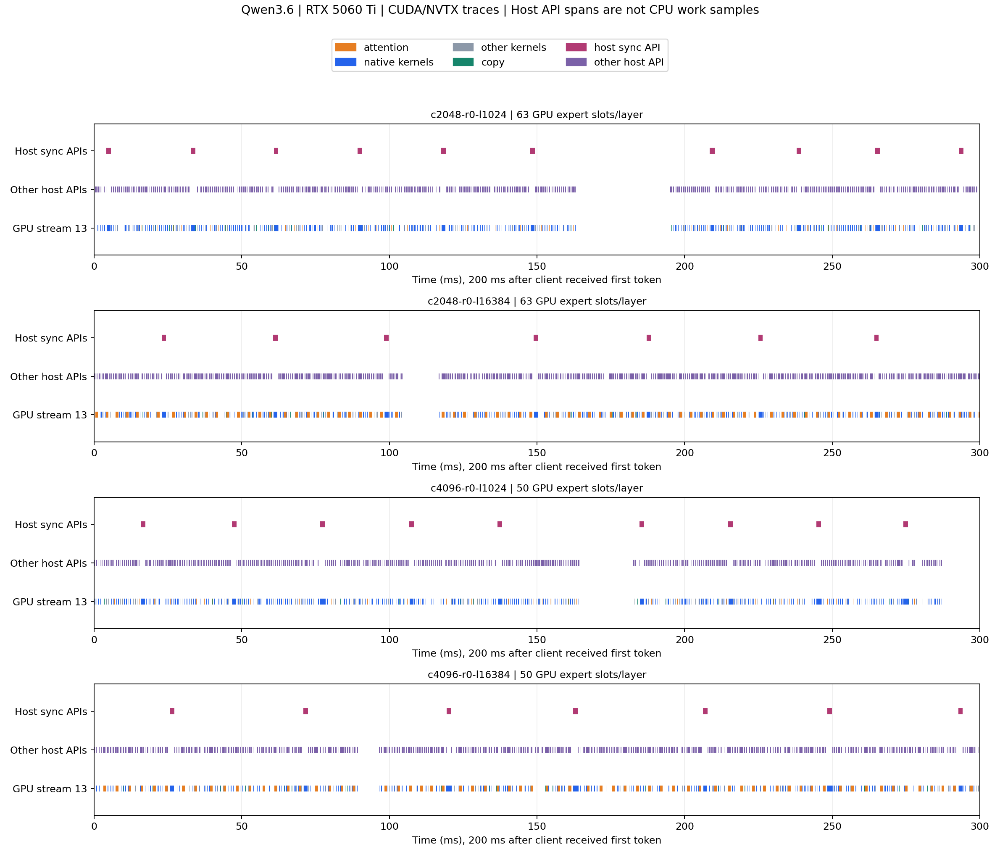

# Qwen3.6 正常工况 CUDA/NVTX 时间线

2026-10-30，北京时间。接续[10-29源码基线](../../tobeo-20261029/qwen36-repro-baseline/README.md)，执行前范围见[experiment-plan.md](experiment-plan.md)。固定46c152a1/源码引擎0.1.53、原Q4模型和exe/DLL，没有修改引擎或日常默认。

**已完成4条同日无profiler参考、4份正式CUDA/NVTX trace及离线验收。** 00:19:18恢复日常Flash-Next0.1.52，health.loaded=true、原模型和配置SHA相同，无恢复错误。随后离线完整性六项检查通过；小型数据见[summary.json](summary.json)、[12行阶段数据](phase-results.csv)，判断见[瓶颈观察](bottleneck-notes.md)。完整请求、引擎日志、nsys与SQLite在本机 `capture-01/`，54份本机证据用哈希清单绑定，未对外发布。

本轮已查到Nsight环境的Administrator privileges=No、Sampling Environment=Fail，因此明确关闭CPU sampling/context switch采集。CUDA runtime API区间不是CPU执行采样，GPU未覆盖时间不自动归因于CPU专家或自旋等待。正常工况的完整CPU归因仍未完成。

## 配置与验收

设备为Windows11、i7-12700、RTX5060 Ti16GB、128GB RAM，驱动610.88。使用已验收的MSVC19.42/CUDA13.2/sm_120二进制；本轮重新核对源码清洁、exe/DLL身份，模型全文件SHA仍为 `55983c5a75a1ab969824077b3bb3de4146e82a9234072b48ad4e8f92ad3fe9f1`。固定32K上限、7workers、MTP0、GPU0、packed Q8/MMQ、纯贪婪且penalty关闭，自动分配后冻结驻留；实际chunk2048/4096分别为每层63/50槽位，全部0换槽。

同一transfer_probe加载前HtoD24.843725、全部采集后24.890607GB/s，两次退出0，正常传输状态保持。没有下载/编译等研究任务争用，未改系统权限、驱动或日常配置。Nsight Systems为2026.1.3.425，CLI版本/哈希与已有安装manifest归档；工具包完整校验是10-22的历史证据，不冒称本轮重下或重新验证整包。

8条正式请求均fresh、64输出、MTP草稿0、length结束；各trace与同chunk的无profiler完整输出一致，chunk2048还与10-29基线一致。每份SQLite都有闭合的request、prefill、decode范围，GPU活动仅来自记录的独立引擎PID。没有驱动不兼容回退、引擎CUDA完整性警告或明确lost/dropped/overflow/error诊断；实际Graph节点与cudaGraphLaunch均为0。

每份仍保留4条角色相关诊断：引擎No NVTX，控制器Not all NVTX、CUDA profiling might have not been started correctly、No CUDA。控制器负责NVTX而不执行模型CUDA，引擎执行CUDA而未加NVTX；已经核对目标范围闭合和引擎GPU活动，不能将此写作“所有警告为零”。

## 同日参考与采集开销

以下每格只有一次，来自原生引擎协议，不是HTTP或统计性能A/B；不剔除较慢样本。

| chunk / 实际输入 | 无profiler prefill ms | 无profiler decode ms | trace/plain prefill | trace/plain decode |
| --- | ---: | ---: | ---: | ---: |
| 2048 / 1025 | 858.3 | 2017.8 | 0.953 | 1.011 |
| 2048 / 16385 | 7425.6 | 2352.5 | 0.986 | 1.047 |
| 4096 / 1025 | 823.1 | 1758.6 | 1.001 | 1.206 |
| 4096 / 16385 | 5566.8 | 2381.2 | 0.994 | 1.101 |

4096/1K decode的trace慢20.6%，4096/16K慢10.1%；这些差异和单次顺序混在一起，不能将trace当作无扰动性能测量，也不能从本轮1K单点推翻此前五组报告的方向。跨chunk输出不要求相同，没有新增质量等价结论。

## Prefill：传输量与计算重叠

NVTX由协议客户端标记；prefill窗口止于收到首token，可能含首个decode及少量后续GPU活动。拷贝字节为与窗口相交的记录之和；本轮所列HtoD记录没有跨窗口边界。GB为十进制。

| chunk / 输入 | 客户端窗口 ms | HtoD GB | copy并集 ms | kernel/copy重叠 ms | GPU活动并集 ms |
| --- | ---: | ---: | ---: | ---: | ---: |
| 2048 / 1K | 849.80 | 19.643 | 796.51 | 313.40 | 825.94 |
| 2048 / 16K | 7329.94 | 157.129 | 6474.40 | 4723.08 | 7278.06 |
| 4096 / 1K | 851.67 | 19.643 | 803.47 | 316.47 | 830.33 |
| 4096 / 16K | 5554.64 | 78.567 | 3286.22 | 3096.23 | 5482.82 |

16K两种配置的HtoD量约相差一倍；copy活动中未与kernel重叠的并集约1751.32→189.99ms。**这支持调查流式专家权重传输和重叠效果，不能把6474ms copy与kernel耗时直接相加或全称为可回收时间。** 已有双缓冲重叠，不是“尚未实现异步拷贝”。两种配置也同时改变槽位、GEMM形状和数值，尚未做交叉隔离。

匹配提交的[stream_kick](https://github.com/Niko1221/Strata/blob/46c152a1310f77cd2f0ce2c7cd213962df14fe83/src/qwen35/q36_engine.cu#L2174)已有整层host复制与GPU驻留/host分段复制两条路径；少于半数专家驻留时选择整层host复制。63/50均低于128，静态上落入同一整层分支，符合本轮每个prompt chunk约19.64GB的观测。**这是匹配源码的静态解释，未执行两条复制路径的A/B，也未确认此门槛在本机不合适。** 注释中的RTX3060测量属于上游，不能当成本机数据。

## Decode：attention贡献与未解释部分

时间均裁剪到收到首token后的NVTX窗口，以区间并集统计，不能保证恰好63个完整step。下列copy与kernel观测重叠均为0，仅限这些decode窗口。

表中同步API仅指名称包含`Synchronize`的调用；`cudaEventQuery`属于其他runtime API，不能由这张表排除事件轮询等待。

| chunk / 输入 | 窗口 ms | GPU并集 ms | copy并集 ms | k_attn_part ms / 占窗口 | GPU未覆盖 ms | 同步API与GPU空隙交集 ms |
| --- | ---: | ---: | ---: | --- | ---: | ---: |
| 2048 / 1K | 2012.56 | 618.19 | 19.97 | 49.15 / 2.44% | 1394.37 | 9.18 |
| 2048 / 16K | 2500.88 | 1139.22 | 20.81 | 559.37 / 22.37% | 1361.66 | 9.79 |
| 4096 / 1K | 2136.43 | 619.81 | 21.45 | 49.03 / 2.29% | 1516.62 | 9.93 |
| 4096 / 16K | 2621.86 | 1132.03 | 20.88 | 555.82 / 21.20% | 1489.82 | 9.60 |

16K的k_attn_part仍是累计GPU耗时最高的kernel，单次均值约888–889µs，1K约79µs；调用次数/边界可能不同，不直接按输出数量归一化。假定该部分全部串行且完全消除，decode窗口的理想加速空间约1.27–1.29倍；实际GQA收益没有测量，整请求还受prefill影响。

16K仍有1362–1490ms未被GPU活动覆盖，其中888–1016ms也不在任何已记录CUDA runtime API内；剩余部分主要与其他runtime API相交，不能都归为cudaStreamSynchronize。匹配源码还有cudaEventQuery自旋、CPU作业组织和专家pool等多种可能来源。**没有CPU采样/调度就不能量化各自贡献；累计进程CPU时间也不是专家关键路径。**



图取收到首token后200–500ms；GPU按stream画，host行为仅画CUDA runtime API跨度。空白不代表CPU没在运行。完整SVG在本机留存，PNG为报告用静态图。

## 复现入口

在仓库根目录执行，依赖既有源码构建、Anaconda的Torch CPU端NVTX绑定及已有Nsight工具，不下载模型或改系统设置：

```powershell
python -u reports/tobeo-20261030/qwen36-systems/run_systems.py --run-id capture-01
python -u reports/tobeo-20261030/qwen36-systems/analyze_systems.py --run-id capture-01
```

已有capture目录拒绝覆盖，重跑使用新的 `capture-NN`。分析只读新trace和已保存请求，不发新模型请求；不使用旧异常工况trace补齐本轮证据。Torch仅提供CPU端NVTX标记，实际模型计算在独立strata-q36子进程中。

每个chunk/输入格子先运行一个无profiler参考，再运行一个trace，均新进程、相同1K/64-token预热、正式64输出，自动预算后冻结驻留。chunk改变实际专家槽位，不把两种配置差异当作纯chunk加速；每格n=1，无统计收益结论。
